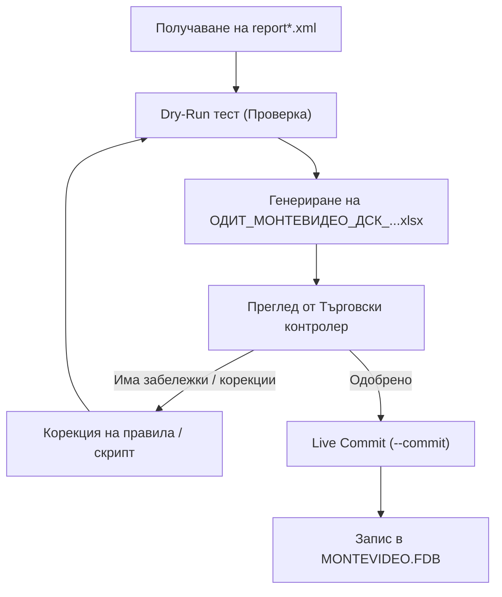

# Банково засичане и отразяване на разплащания в Мистрал ERP (Монтевидео)

Това ръководство съдържа пълните технически спецификации, бази данни, алгоритми за съпоставяне и оперативни правила за разчитане на банкови извлечения от Банка ДСК (DAIS eBank XML) и автоматично отразяване на плащанията в Мистрал ERP.

---

## 🖥️ 1. Конфигурация и параметри на средата

### А. Целева база данни (Централен офис — Монтевидео)
* **Хост:** `192.168.5.254` (SMSERVERBIG)
* **Порт:** `3050`
* **Файл на базата данни:** `E:/db/MONTEVIDEO.FDB`
* **Потребител:** `SYSDBA` / `masterkey`
* **Charset:** `WIN1251`
* **⚠️ КРИТИЧНО ПРАВИЛО ЗА СИГУРНОСТ (БЕЗ НЕСЪГЛАСУВАНИ ПРОМЕНИ):** 
  Базата данни `CS.FDB` (Централен склад) **НИКОГА НЕ СЕ МОДИФИЦИРА** при банкови плащания. Всички банкови движения, разплащания към доставчици, наеми и закривания на задължения се извършват **единствено и само в `MONTEVIDEO.FDB`**.
  **Категорично се забраняват** каквито и да било промени в базата данни (`INSERT`, `UPDATE`, `DELETE`, преименуване на номенклатури, обединяване на партньори) без изрично потвърждение или изрична инструкция от потребителя. Всяка обработка първо се изпълнява в Dry-Run режим.

### Б. Целева каса („ДСК Бакалия“)
* **Име на касата:** `ДСК Бакалия`
* **Във Firebird таблица `MONEYFLOWUNIT`:** `ID = 179607`
* **Във Firebird таблица `MONEYFLOWUNITNAME`:** `ID = 52`
* **В транзакциите (`DEFERREDPAYMENTTRANSACTION` / `MONEYFLOW`):** `MONEYFLOWUNITNAMEID = 52`

### В. Оператор по подразбиране
* **Име на оператор:** `Тонев`
* **Във Firebird:** `USERID = 33`, `USERNAMEID = 33`
* Операторът притежава пълни права върху каса „ДСК Бакалия“ (ID 52).

### Г. Собствени IBAN сметки на веригата
* `BG92STSA93000031252804`: ДСК — „Бакалия 2014 ООД“ (Основна разплащателна)
* `BG44FINV91501016121573`: ПИБ — „Бакалия 2014 ООД“
* `7291014430029999`: ДСК Служебна сметка (Банкови такси)

---

## ⚡ 2. Оперативен цикъл на изпълнение

Обработката на ново банково извлечение (`report*.xml`) преминава през 3 задължителни стъпки:



### Стъпка 1: Dry-Run проверка и генериране на одитен доклад
Изпълнява се скриптът в тестов режим:
```powershell
python "g:\My Drive\AntiG_test\bank_reconciliation.py" --xml "report (2).xml"
```
* **Резултат:** Създава се одитен файл `ОДИТ_МОНТЕВИДЕО_ДСК_[ИМЕ].xlsx`.
* **Базата данни НЕ се променя.**

### Стъпка 2: Одит и верификация
Финансовият аналитик/контролер преглежда генерирания Excel доклад спрямо критериите за точност.

### Стъпка 3: Live Commit (Запис в Мистрал)
След изрично потвърждение се пуска реалният запис:
```powershell
python "g:\My Drive\AntiG_test\bank_reconciliation.py" --xml "report (2).xml" --commit
```

---

## 🕒 3. Критични правила за запис и одит

### Правило 1: Реална дата и час на извършване на разплащането
* **Изискване:** В Мистрал в разплащанията **задължително се отразява датата и часът, в който се извършва разплащането** (`datetime.datetime.now()`), а не просто вальорът от банковото извлечение.
* **Причина:** Осигурява стриктна хронология на касовите ордери и прецизен одит по оператори в Мистрал.
* **Полета:** `TRANSDATE`, `RECORDDATE`, `FLOWDATE` се записват с текущия времеви печат на транзакцията.

### Правило 2: Форматиране на одитния Excel файл
* **Колона F (Сума):**
  * **Дебит (Debit — плащания към доставчици, разходи, наеми):** Задължително се записват с **минусов знак (`-`)** и червен шрифт (напр. `-1 465.40 €`).
  * **Кредит (Credit — постъпления, входящи плащания за БО):** Записват се с **положителен знак (`+`)** и зелен шрифт (напр. `+220.00 €`).
* **Валута по периоди:**
  * **От 01.01.2026 г. нататък:** Всички суми се записват и обработват в **Евро (€)**.
  * **Преди 01.01.2026 г.:** Всички исторически извлечения и плащания са в **Български лева (лв. / BGN)**.
* **Банкови такси:**
  * Всички банкови такси за деня/периода (напр. такси за преводи, такси по пакети) се **консолидират на един общ ред** в одитния доклад:
    `Банкови такси ДСК (общо X бр.)` със сумирана обща стойност, вместо да се разпиляват поотделно.

### Правило 3: Anti-FIFO контрол (Забрана за сляпо закриване по най-стар документ)
* **Проблем:** При сляпо FIFO, ако партньорът плати нова фактура, но има по-стара неплатена със същата сума, системата ще закрие грешния запис.
* **Казус „Голд Груп Барона ЕООД“:**
  * Партньорът преведе 220.00 € с основание `Ф-РА 9000005908/08.09.2026`.
  * В Мистрал имаше отворена стара фактура от 06.08 за 220.00 € и по-нова от 08.09 за 220.00 €.
  * Поради сляпо FIFO беше закрит записът от 06.08. Контрагентът всъщност е прескочил плащане по по-старата фактура!
* **Задължителен Anti-FIFO протокол:**
  1. **Извличане на метаданни:** Скриптът сканира основанието за дати (`DD.MM.YYYY`, `DD.MM`) и номера на фактури (`9000...`, `1000...`).
  2. **Приоритет на посочения документ:** Ако в основанието е посочена дата/номер, съпоставката се прави **строго към съответния документ**, дори да има по-стари отворени записи.
  3. **Сигнализация `⚠️ [ПРЕСКОЧЕН ПО-СТАР ДОКУМЕНТ]`:** Ако посоченият документ е по-нов от най-стария отворен запис, редът се маркира с предупреждение, за да се уведоми контрагентът за просрочието по старата фактура.
  4. **Множествени съвпадения без дата:** Ако има 2+ отворени документа с абсолютно еднаква сума и няма дата в основанието, скриптът **НЕ закрива автоматично**, а поставя статус `[ДУБЛИРАНА СУМА - ИЗИСКВА ИЗБОР]`.

### Правило 4: Водеща роля на банковия поток (Debit vs Credit) за посоката в касата
* **Златно правило:** Посоката на касовата операция в Мистрал се определя **СТРОГО от реалния банков поток**:
  * **Debit (Изходящ превод):** Парите напускат банковата сметка $\rightarrow$ **ВИНАГИ „Теглене на пари“ (-разход)** (`OPERATIONTYPE = 7`, `OPERATIONID = 9`), независимо от типа на закривания документ в Мистрал (`dp_optype_id`).
  * **Credit (Входящ превод):** Парите влизат в банковата сметка $\rightarrow$ **ВИНАГИ „Внасяне на пари“ (+приход)** (`OPERATIONTYPE = 8`, `OPERATIONID = 10`).
* **Защита срещу обърнат знак при наеми и депозити:** Ако в Мистрал салдо/депозит по наем е заведено като тип 3 (вземане), при изходящ превод (`Debit`) скриптът задължително го записва като Теглене (`OPERATIONTYPE = 7`, `OPERATIONTYPEID = 2`), за да се предотврати изкуствено завишаване на касовата наличност.

---

## 🏢 4. Специални протоколи по контрагенти

### А. Наеми, наемодатели и частично закриване в Мистрал
Всички банкови плащания за наеми се закриват към следните строго определени партньори в `MONTEVIDEO.FDB`:

| Лице / Платец от банката | Контрагент в Мистрал | PARTNER.NUM | PARTNERNAME.ID | Специфика на разплащането и закриването |
| :--- | :--- | :---: | :---: | :--- |
| **АНТОНИО ВАСИЛЕВ КРЪСТАКИЕВ** | **`Наем Арсеналски`** (`Наем Аресналски`) | **1259** | **531** | Съсобственик. Закрива се частично сумата (напр. ~915.53 € или 1 286.67 € от общо 2 420.00 €). |
| **ЦВЕТЕЛИНА ВАСИЛЕВА КРЪСТАКИЕВА** | **`Наем Арсеналски`** (`Наем Аресналски`) | **1259** | **531** | Съсобственик. Закрива се частично сумата (заедно с Антонио превеждат 2 202.20 €, остава 217.80 € данък м.1-9). |
| **АСТАРТА ФИНИС ООД.** | **`Астарта Финис`** | **1216** | **421** | Юридическо лице. Закриване по месечна фактура/начисление (напр. 3 400.00 € / 805.10 €). |
| **МАРТИН ПЕТЕВ БОТЕВ** | **`Наем чужденци`** | **392** | **927** | Наеми на апартаменти за персонал. Закрива се частично на траншове по апартаменти (напр. 455.00 €, 637.00 €, 715.81 €). |
| **РАДОСВЕТА АТАНАСОВА ЗАХАРИЕВА** | **`Наем Манастирски`** (`Наем Манастирски - Георги Русчев`) | **1405** | **644** | Съсобственик. Закрива се частично сумата (напр. 232.69 € от 755.64 €). |
| **ГЕОРГИ РУСЧЕВ** | **`Наем Манастирски`** (`Наем Манастирски - Георги Русчев`) | **1405** | **644** | Съсобственик. Закрива се частично сумата (напр. 455.00 €; заедно с Радосвета = 687.69 €, остава 67.95 € данък м.1-9). |
| **КАНЗАС КЕПИТЪЛ ООД** | **`Канзас кепитъл`** | **1416** | **649** | Юридическо лице. Наем за търговски площи. |
| **ЕТА ЖЕЛЕВА ЕООД** | **`ЕТА-Желева ЕООД`** | **176** | **983** | Юридическо лице. Пълен месечен наем 2 699.62 €. |
| **МАТЬО АНГЕЛОВ АНГЕЛОВ** | **`Наем Велчо Атанасов`** | **1567** | **717** | Физическо лице. Закрива се частично сумата (напр. 2 085.04 € + 695.01 € от 3 055.00 €; остава 274.95 € данък м.1-9). |
| **Наемодатели „Окръжна“** (*Анка Иванова, Рачо Рачев, Димитър Иванов, Силвия Иванова*) | **`Наем Окръжна болница`** | **61** | **786** | Съсобственици (по 1/4 част). М. 1–9: 4 x 1 395.83 € (остава 552.18 € данък); М. 10–12: пълно закриване без удръжка (чл. 65(12) ЗДДФЛ). |

#### Правило за частично закриване и отразяване в базата данни:
1. **DEFERREDPAYMENT:** При частично плащане документът **НЕ се изтрива**. Вместо това отвореното салдо се редуцира с платената сума:
   $$\text{DPSUM}_{new} = \text{DPSUM}_{old} - \text{Платена сума}$$
2. **DEFERREDPAYMENTTRANSACTION:** Записва се `SUMPAYED = Платена сума` и `SUMDEFERREDPAYMENT = \text{DPSUM}_{new}`.
3. **MONEYFLOW & MONEYFLOWUNIT:** Каса `ДСК Бакалия` се дебитира точно с реално изплатената сума по банков път.
4. **Удържани данъци при източника (чл. 44 / чл. 65 ЗДДФЛ):** За физическите лица през тримесечия 1–3 оставащите суми в `DEFERREDPAYMENT` отразяват удържания авансов данък и не се третират като разминаване.

### Б. Насрещни прихващания (Компенсации / Netting)
* **Принцип:** Доставчик приспада задължение за БО/маркетинг от сумата за плащане по доставка.
* **Автоматично разпознаване и закриване:**
  Когато банковото основание съдържа референция към фактури („НАША [№]“, „НАШИ [№]“, „ОПИС [дата]“) или при уникално математическо салдо:
  $$\text{Доставка (OpType 2)} - \text{Бонус/Вземане (OpType 3)} = \text{Банков превод} \quad (\pm 0.05 \text{ €})$$
  системата автоматично задава статус `🟢 [ГОТОВО ЗА ЗАКРИВАНЕ (Прихващане / Компенсация)]` и изпълнява автоматично двойно закриване в Мистрал ERP.
* **Архитектура на двойната транзакция в каса `ДСК Бакалия`:**
  1. **Транзакция 1 (Доставка):** Разход (`OPERATIONTYPE = 7`, `OPERATIONID = 9`, `mf_op_type = 7`, каса delta $= -\text{Доставка}$). Отвореният запис в `DEFERREDPAYMENT` за доставката се изтрива/закрива.
  2. **Транзакция 2 (БО / Вземане):** Приход (`OPERATIONTYPE = 8`, `OPERATIONID = 10`, `mf_op_type = 8`, каса delta $= +\text{Бонус}$). Отвореният запис в `DEFERREDPAYMENT` за БО се изтрива/закрива.
  3. **Нето салдо в каса `ДСК Бакалия`:**
     $$\Delta \text{Каса} = -\text{Доставка} + \text{Бонус} = -(\text{Доставка} - \text{Бонус}) = -\text{Банков превод}$$
     Касовата наличност спада с точното изплатено нето по банков път.
  4. **Репликация към Централен склад (CS):** В `SYNCHRONIZATIONLOG` се генерират 2 отделни пакета `SAVEPAYRAZCR` (един с `ActionId = 2` за доставката и един с `ActionId = 3` за БО фактурата).
* **Примери от практиката:**
  * **Венекс Трейд ООД:** Доставка `111851` (1 465.40 €) − БО `77133` (220.00 €) = 1 245.40 € (Основание: `1000037075,НАША 5896`).
  * **Данон Сердика АД:** Доставка `112102` (1 879.28 €) − БО Алпро `77244` (68.80 €) = 1 810.48 € (Основание: `OPIS 17.09`).
  * **ЕМГ Комерсиал ООД:** Доставка `111992` (10 768.67 €) − БО `77154` (1 556.08 €) = 9 212.59 € (Основание: `ОПИС 16-31.07, НАШИ 5920,21`).
* **Защита от повторно записване:** Вече изпълнените компенсации в базата автоматично се засичат като `🟡 [ВЕЧЕ ЗАКРИТО В МИСТРАЛ]` чрез проверка за двойка насрещни транзакции за съответния период.

### В. Алиаси и бързо разпознаване на контрагенти в Мистрал
* `КЕСКИН` $\rightarrow$ `PARTNER.NUM = 105` („КЕСКИН ТРЕЙДИНГ ЕООД“)
* `ТАНДЕМ` $\rightarrow$ `PARTNER.NUM = 137` („ТАНДЕМ ПОПОВ ООД“)
* `ГОЛД ГРУП БАРОНА` $\rightarrow$ `PARTNER.NUM = 1191`
* `ЕМГ КОМЕРСИАЛ` $\rightarrow$ обслужва Тимбарк и Девин
* `ХЕЛИОСАГРО` $\rightarrow$ доставки за плодове и зеленчуци

---

## 🗄️ 5. Firebird SQL транзакции и архитектура в Мистрал

При изпълнение на `--commit` скриптът генерира запис в две свързани таблици:

### 1. Таблица `DEFERREDPAYMENTTRANSACTION` (Транзакция за отложено плащане)
```sql
INSERT INTO DEFERREDPAYMENTTRANSACTION (
    ID, DEFERREDPAYMENTID, TRANSDATE, RECORDDATE, AMOUNT,
    MONEYFLOWUNITID, MONEYFLOWUNITNAMEID, USERID, USERNAMEID, DESCRIPTION
) VALUES (
    GEN_ID(GEN_DEFERREDPAYMENTTRANSACTION, 1),
    :deferred_payment_id,
    '2026-09-19 21:00:00',  -- Текущ реален времеви печат!
    '2026-09-19 21:00:00',
    :payment_amount,
    179607,                 -- MONEYFLOWUNIT ID за ДСК Бакалия
    52,                     -- MONEYFLOWUNITNAME ID за ДСК Бакалия
    33,                     -- USERID за Тонев
    33,                     -- USERNAMEID за Тонев
    :reason_text
);
```

### 2. Таблица `MONEYFLOW` (Паричен поток / Касов ордер)
```sql
INSERT INTO MONEYFLOW (
    ID, FLOWDATE, RECORDDATE, AMOUNT,
    MONEYFLOWUNITID, MONEYFLOWUNITNAMEID, USERID, USERNAMEID,
    PARTNERID, DESCRIPTION, FLOWTYPE
) VALUES (
    GEN_ID(GEN_MONEYFLOW, 1),
    '2026-09-19 21:00:00',  -- Текущ реален времеви печат!
    '2026-09-19 21:00:00',
    :payment_amount,
    179607,
    52,
    33,
    33,
    :partner_id,
    :description,
    :flow_type              -- 1 = Разход (Дебит), 2 = Приход (Кредит)
);
```

### 3. Таблица `SYNCHRONIZATIONLOG` (Репликация към CS.FDB и обновяване на салда)
За да се репликира плащането към Централния склад (`CS.FDB`) и да се актуализира салдото на доставчика, всяко разплащане генерира запис в `SYNCHRONIZATIONLOG`:
```sql
INSERT INTO SYNCHRONIZATIONLOG (
    ID, LOCATIONID, DATESAVE, SYNCHROLOG
) VALUES (
    GEN_ID(G_SYNCHRONIZATIONLOG, 1),
    7,                      -- Обект 7 (Монтевидео)
    '2026-09-23 13:00:00',
    'SAVEPAYRAZCR\x1dObektId\x1d7\x1dSmetkaNo\x1d112020\x1dActionId\x1d2\x1dTypeDb\x1d2\x1dPaySuma\x1d1466.580\x1dObektName\x1dМОНТЕВИДЕО\x1ddtPay\x1d...\x1dPartnerName\x1d...\x1dOper\x1dТонев\x1dSumRazcr\x1d0.000\x1dDocType\x1dСтокова разписка\x1d...\x1d'
);
```

> [!CRITICAL]
> **Критично правило за `ActionId` в `SYNCHRONIZATIONLOG`:**
> `ActionId` в пакета `SAVEPAYRAZCR` **задължително съответства на `OPERATIONTYPEID` на закривания документ**:
> * **За доставки (Стокови разписки, `OPERATIONTYPEID = 2`):** `ActionId = '2'`, `DocType = 'Стокова разписка'`.
> * **За продажби / БО (Фактури, `OPERATIONTYPEID = 3`):** `ActionId = '3'`, `DocType = 'Фактура'`.
> 
> *Защо е критично:* Когато `SyncManager.exe` импортира пакета в `CS.FDB`, той изпълнява изтриване на задължението по филтър `WHERE LOCATIONID = :ObektId AND SALENUM = :SmetkaNo AND OPERATIONTYPEID = :ActionId`. Ако за доставка се подаде `ActionId = 3`, синхронизаторът вмъква транзакцията в `DEFERREDPAYMENTTRANSACTION`, но не намира ред с тип 3 в `DEFERREDPAYMENT` и сметката остава незакрита в Централен склад!

Когато фоновият процес `SyncManager.exe` изпълни регулярната синхронизация между обектите:
1. Прочита новите записи от `SYNCHRONIZATIONLOG` в `MONTEVIDEO.FDB`.
2. Изпълнява съхранената процедура `SAVEPAYRAZCR` в `CS.FDB`.
3. В `CS.FDB` се закрива редът в `DEFERREDPAYMENT`, записва се транзакция в `DEFERREDPAYMENTTRANSACTION` и **автоматично се намалява дължимото салдо на доставчика**.
4. За синхронизиране на минали партиди се използва скриптът:
   ```powershell
   python sync_past_payments.py
   ```

---

## 🛡️ 6. Контролен списък за проверка (Checklist)

Преди финално съгласуване на одитен доклад, агентът проверява:
- [ ] Базата данни е строго `MONTEVIDEO.FDB`, а не `CS.FDB`.
- [ ] Касата е „ДСК Бакалия“ (ID 52 / 179607), операторът е Тонев (ID 33).
- [ ] Времевият печат е текущият час и дата на изпълнение.
- [ ] Всички дебити са с минус (`-`), а кредитите с плюс (`+`) в колона F.
- [ ] Банковите такси са сумирани на един общ ред.
- [ ] Наем Окръжна болница оставя 552.18 € неразплатени за месеци 1–9.
- [ ] Няма сляпо FIFO закриване на по-стар документ, ако е цитирана нова фактура.
- [ ] Редовете с `⚠️ [ПРЕСКОЧЕН ПО-СТАР ДОКУМЕНТ]` са изведени за уведомяване на партньора.
