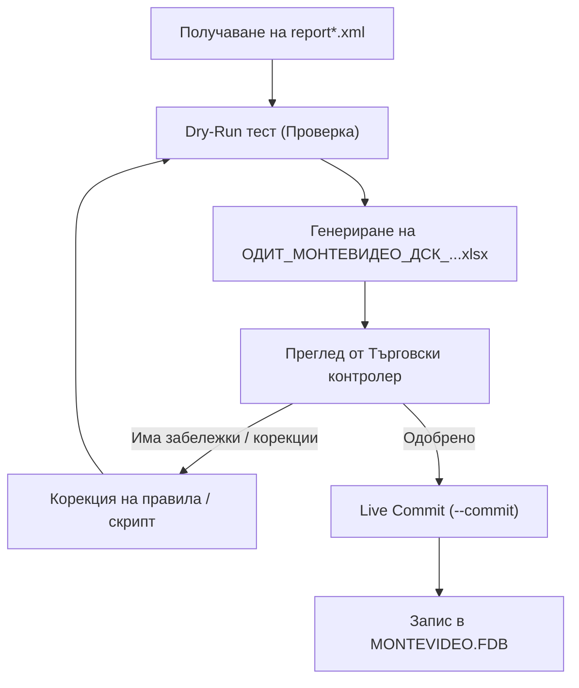

# Банково засичане и отразяване на разплащания в Мистрал ERP (Монтевидео)

Това ръководство съдържа пълните технически спецификации, бази данни, алгоритми за съпоставяне и оперативни правила за разчитане на банкови извлечения от Банка ДСК (DAIS eBank XML) и автоматично отразяване на плащанията в Мистрал ERP.

---

## 🖥️ 1. Конфигурация и параметри на средата

### А. Целева база данни (Централен офис — Монтевидео)
* **Хост:** `192.168.5.254` (SMSERVERBIG)
* **Порт:** `3050`
* **Файл на базата данни:** `E:/db/MONTEVIDEO.FDB`
* **Потребител:** `SYSDBA` / `masterkey`
* **Charset:** `WIN1251`
* **⚠️ КРИТИЧНО ПРАВИЛО ЗА СИГУРНОСТ:** 
  Базата данни `CS.FDB` (Централен склад) **НИКОГА НЕ СЕ МОДИФИЦИРА** при банкови плащания. Всички банкови движения, разплащания към доставчици, наеми и закривания на задължения се извършват **единствено и само в `MONTEVIDEO.FDB`**.

### Б. Целева каса („ДСК Бакалия“)
* **Име на касата:** `ДСК Бакалия`
* **Във Firebird таблица `MONEYFLOWUNIT`:** `ID = 179607`
* **Във Firebird таблица `MONEYFLOWUNITNAME`:** `ID = 52`
* **В транзакциите (`DEFERREDPAYMENTTRANSACTION` / `MONEYFLOW`):** `MONEYFLOWUNITNAMEID = 52`

### В. Оператор по подразбиране
* **Име на оператор:** `Тонев`
* **Във Firebird:** `USERID = 33`, `USERNAMEID = 33`
* Операторът притежава пълни права върху каса „ДСК Бакалия“ (ID 52).

### Г. Собствени IBAN сметки на веригата
* `BG92STSA93000031252804`: ДСК — „Бакалия 2014 ООД“ (Основна разплащателна)
* `BG44FINV91501016121573`: ПИБ — „Бакалия 2014 ООД“
* `7291014430029999`: ДСК Служебна сметка (Банкови такси)

---

## ⚡ 2. Оперативен цикъл на изпълнение

Обработката на ново банково извлечение (`report*.xml`) преминава през 3 задължителни стъпки:



### Стъпка 1: Dry-Run проверка и генериране на одитен доклад
Изпълнява се скриптът в тестов режим:
```powershell
python "g:\My Drive\AntiG_test\bank_reconciliation.py" --xml "report (2).xml"
```
* **Резултат:** Създава се одитен файл `ОДИТ_МОНТЕВИДЕО_ДСК_[ИМЕ].xlsx`.
* **Базата данни НЕ се променя.**

### Стъпка 2: Одит и верификация
Финансовият аналитик/контролер преглежда генерирания Excel доклад спрямо критериите за точност.

### Стъпка 3: Live Commit (Запис в Мистрал)
След изрично потвърждение се пуска реалният запис:
```powershell
python "g:\My Drive\AntiG_test\bank_reconciliation.py" --xml "report (2).xml" --commit
```

---

## 🕒 3. Критични правила за запис и одит

### Правило 1: Реална дата и час на извършване на разплащането
* **Изискване:** В Мистрал в разплащанията **задължително се отразява датата и часът, в който се извършва разплащането** (`datetime.datetime.now()`), а не просто вальорът от банковото извлечение.
* **Причина:** Осигурява стриктна хронология на касовите ордери и прецизен одит по оператори в Мистрал.
* **Полета:** `TRANSDATE`, `RECORDDATE`, `FLOWDATE` се записват с текущия времеви печат на транзакцията.

### Правило 2: Форматиране на одитния Excel файл
* **Колона F (Сума):**
  * **Дебит (Debit — плащания към доставчици, разходи, наеми):** Задължително се записват с **минусов знак (`-`)** и червен шрифт (напр. `-1 465.40 €`).
  * **Кредит (Credit — постъпления, входящи плащания за БО):** Записват се с **положителен знак (`+`)** и зелен шрифт (напр. `+220.00 €`).
* **Банкови такси:**
  * Всички банкови такси за деня/периода (напр. такси за преводи, такси по пакети) се **консолидират на един общ ред** в одитния доклад:
    `Банкови такси ДСК (общо X бр.)` със сумирана обща стойност, вместо да се разпиляват поотделно.

### Правило 3: Anti-FIFO контрол (Забрана за сляпо закриване по най-стар документ)
* **Проблем:** При сляпо FIFO, ако партньорът плати нова фактура, но има по-стара неплатена със същата сума, системата ще закрие грешния запис.
* **Казус „Голд Груп Барона ЕООД“:**
  * Партньорът преведе 220.00 € с основание `Ф-РА 9000005908/08.09.2026`.
  * В Мистрал имаше отворена стара фактура от 06.08 за 220.00 € и по-нова от 08.09 за 220.00 €.
  * Поради сляпо FIFO беше закрит записът от 06.08. Контрагентът всъщност е прескочил плащане по по-старата фактура!
* **Задължителен Anti-FIFO протокол:**
  1. **Извличане на метаданни:** Скриптът сканира основанието за дати (`DD.MM.YYYY`, `DD.MM`) и номера на фактури (`9000...`, `1000...`).
  2. **Приоритет на посочения документ:** Ако в основанието е посочена дата/номер, съпоставката се прави **строго към съответния документ**, дори да има по-стари отворени записи.
  3. **Сигнализация `⚠️ [ПРЕСКОЧЕН ПО-СТАР ДОКУМЕНТ]`:** Ако посоченият документ е по-нов от най-стария отворен запис, редът се маркира с предупреждение, за да се уведоми контрагентът за просрочието по старата фактура.
  4. **Множествени съвпадения без дата:** Ако има 2+ отворени документа с абсолютно еднаква сума и няма дата в основанието, скриптът **НЕ закрива автоматично**, а поставя статус `[ДУБЛИРАНА СУМА - ИЗИСКВА ИЗБОР]`.

---

## 🏢 4. Специални протоколи по контрагенти

### А. Наемодатели на магазин „Окръжна болница“ (NUM = 61, NameID = 786)
* **Съсобственици (4 физически лица):**
  1. *АНКА ИВАНОВА*
  2. *РАЧО ИВАНОВ РАЧЕВ*
  3. *ДИМИТЪР РАЧЕВ ИВАНОВ*
  4. *СИЛВИЯ ЖОРИЕВА ЖИВКОВА ИВАНОВА*
* **Партида в Мистрал:** Всички преводи към тези 4 лица се обединяват и отнасят към партида **`Наем Окръжна болница`** (`PARTNER.NUM = 61`, `PARTNERNAME.ID = 786`).
* **Период 1: Януари – Септември (Месеци 1 до 9):**
  * Превеждат се по **1 395.83 €** на съсобственик (общо **5 583.32 €** нетен наем).
  * По документа в Мистрал (напр. док. 111894 за 6 135.50 €) **остава отворена неразплатена сума от 552.18 €**.
  * Тази разлика представлява удържан авансов данък и осигуровки по ЗДДФЛ. Тя **НЕ е грешка и НЕ се закрива** в Мистрал!
* **Период 2: Октомври – Декември (Месеци 10 до 12):**
  * По силата на чл. 65, ал. 12 от ЗДДФЛ през четвъртото тримесечие не се удържа авансов данък от платеца на дохода.
  * Преводите към наемодателите са в различен (пълен) размер и тогава **се изчиства цялата заприходена сума** по документа в Мистрал.

### Б. Насрещни прихващания (Компенсации / Netting)
* **Принцип:** Доставчик приспада задължение за БО/маркетинг от сумата за плащане по доставка.
* **Казус „Венекс Трейд ООД“:**
  * Фактура за доставка: `111851` за `1 465.40 €`.
  * Фактура за БО: `77133` за `220.00 €`.
  * Банков превод: `1 245.40 €` (нето).
  * **Решение:** В Мистрал се отразява плащането от 1 245.40 € към доставката, а остатъкът от 220.00 € се прихваща срещу вземането за БО чрез протокол за компенсация.

### В. Алиаси и бързо разпознаване на контрагенти в Мистрал
* `КЕСКИН` $\rightarrow$ `PARTNER.NUM = 105` („КЕСКИН ТРЕЙДИНГ ЕООД“)
* `ТАНДЕМ` $\rightarrow$ `PARTNER.NUM = 137` („ТАНДЕМ ПОПОВ ООД“)
* `ГОЛД ГРУП БАРОНА` $\rightarrow$ `PARTNER.NUM = 1191`
* `ЕМГ КОМЕРСИАЛ` $\rightarrow$ обслужва Тимбарк и Девин
* `ХЕЛИОСАГРО` $\rightarrow$ доставки за плодове и зеленчуци

---

## 🗄️ 5. Firebird SQL транзакции и архитектура в Мистрал

При изпълнение на `--commit` скриптът генерира запис в две свързани таблици:

### 1. Таблица `DEFERREDPAYMENTTRANSACTION` (Транзакция за отложено плащане)
```sql
INSERT INTO DEFERREDPAYMENTTRANSACTION (
    ID, DEFERREDPAYMENTID, TRANSDATE, RECORDDATE, AMOUNT,
    MONEYFLOWUNITID, MONEYFLOWUNITNAMEID, USERID, USERNAMEID, DESCRIPTION
) VALUES (
    GEN_ID(GEN_DEFERREDPAYMENTTRANSACTION, 1),
    :deferred_payment_id,
    '2026-09-19 21:00:00',  -- Текущ реален времеви печат!
    '2026-09-19 21:00:00',
    :payment_amount,
    179607,                 -- MONEYFLOWUNIT ID за ДСК Бакалия
    52,                     -- MONEYFLOWUNITNAME ID за ДСК Бакалия
    33,                     -- USERID за Тонев
    33,                     -- USERNAMEID за Тонев
    :reason_text
);
```

### 2. Таблица `MONEYFLOW` (Паричен поток / Касов ордер)
```sql
INSERT INTO MONEYFLOW (
    ID, FLOWDATE, RECORDDATE, AMOUNT,
    MONEYFLOWUNITID, MONEYFLOWUNITNAMEID, USERID, USERNAMEID,
    PARTNERID, DESCRIPTION, FLOWTYPE
) VALUES (
    GEN_ID(GEN_MONEYFLOW, 1),
    '2026-09-19 21:00:00',  -- Текущ реален времеви печат!
    '2026-09-19 21:00:00',
    :payment_amount,
    179607,
    52,
    33,
    33,
    :partner_id,
    :description,
    :flow_type              -- 1 = Разход (Дебит), 2 = Приход (Кредит)
);
```

### 3. Таблица `SYNCHRONIZATIONLOG` (Репликация към CS.FDB и обновяване на салда)
За да се репликира плащането към Централния склад (`CS.FDB`) и да се актуализира салдото на доставчика, всяко разплащане генерира запис в `SYNCHRONIZATIONLOG`:
```sql
INSERT INTO SYNCHRONIZATIONLOG (
    ID, LOCATIONID, DATESAVE, SYNCHROLOG
) VALUES (
    GEN_ID(G_SYNCHRONIZATIONLOG, 1),
    7,                      -- Обект 7 (Монтевидео)
    '2026-09-23 13:00:00',
    'SAVEPAYRAZCR\x1dObektId\x1d7\x1dSmetkaNo\x1d112020\x1dActionId\x1d3\x1dTypeDb\x1d2\x1dPaySuma\x1d1466.580\x1dObektName\x1dМОНТЕВИДЕО\x1ddtPay\x1d...\x1dPartnerName\x1d...\x1dOper\x1dТонев\x1dSumRazcr\x1d0.000\x1d...\x1d'
);
```
Когато фоновият процес `SyncManager.exe` изпълни регулярната синхронизация между обектите:
1. Прочита новите записи от `SYNCHRONIZATIONLOG` в `MONTEVIDEO.FDB`.
2. Изпълнява съхранената процедура `SAVEPAYRAZCR` в `CS.FDB`.
3. В `CS.FDB` се закрива редът в `DEFERREDPAYMENT`, записва се транзакция в `DEFERREDPAYMENTTRANSACTION` и **автоматично се намалява дължимото салдо на доставчика**.
4. За синхронизиране на минали партиди се използва скриптът:
   ```powershell
   python sync_past_payments.py
   ```

---

## 🛡️ 6. Контролен списък за проверка (Checklist)

Преди финално съгласуване на одитен доклад, агентът проверява:
- [ ] Базата данни е строго `MONTEVIDEO.FDB`, а не `CS.FDB`.
- [ ] Касата е „ДСК Бакалия“ (ID 52 / 179607), операторът е Тонев (ID 33).
- [ ] Времевият печат е текущият час и дата на изпълнение.
- [ ] Всички дебити са с минус (`-`), а кредитите с плюс (`+`) в колона F.
- [ ] Банковите такси са сумирани на един общ ред.
- [ ] Наем Окръжна болница оставя 552.18 € неразплатени за месеци 1–9.
- [ ] Няма сляпо FIFO закриване на по-стар документ, ако е цитирана нова фактура.
- [ ] Редовете с `⚠️ [ПРЕСКОЧЕН ПО-СТАР ДОКУМЕНТ]` са изведени за уведомяване на партньора.
